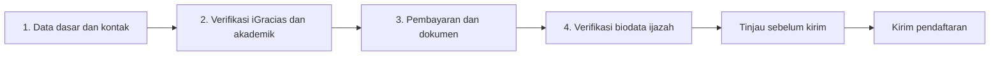

# 03 — Peta fitur dan rancangan Sidang TA student

Tanggal scan: 1 November 2026. Status: panduan pengerjaan, belum diimplementasikan. Baca berurutan: dokumen ini → [04 upload](04-perbaikan-upload-sidang-ta.md) → [05 implementasi](05-langkah-form-empat-tahap-sidang-ta.md) → [06 verifikasi](06-checklist-rescan-sidang-ta.md). [07 catatan pendamping](07-catatan-pendamping-sidang-ta.md) menyimpan konteks untuk sesi berikutnya.

## Kesepakatan kerja

- Pengguna mengerjakan kode sendiri di `/home/xdranel/Code/Project/php-laravel/dadu/`, kemudian memindahkan hasil ke `/home/xdranel/Code/Project/secret/dadu-test/` untuk diperiksa.
- Asisten hanya menulis `docs/*.md` di dadu-test. Jangan mengubah kode, `.env`, konfigurasi PHP, database, atau folder asli. Blok kode/perintah dalam dokumen adalah instruksi untuk pengguna, bukan tindakan yang sudah dilakukan.
- Fokus sekarang student: upload → Mulai Pendaftaran empat tahap → tinjau dan kirim → detail riwayat. Desain operasional petugas menunggu penjelasan pengguna.
- Permission tetap dapat diatur superadmin; jangan menambahkan pemeriksaan nama role baru yang menutup kemampuan konfigurasi itu.
- Akun uji yang diberikan pengguna: `krisna@mahasiswa.test` / `password`. Pilih role aktif **Mahasiswa** melalui switcher di atas logout sebelum menguji student.

## Hasil scan dua folder

434 berkas diperiksa di `app`, `routes`, `resources`, `database`, `tests`, `bootstrap`, dan `config`. Sumber yang ditemukan sama pada kedua folder; perbedaan hanya `database/database.sqlite` yang ada di dadu-test. Pemeriksaan ini tidak menyatakan isi database MySQL, `.env`, dependensi terpasang, atau PHP runtime kedua folder/laptop identik.

| Area | Berkas yang ada | Perilaku sekarang |
| --- | --- | --- |
| Route | `routes/web.php:311` | Student create/store/show/edit/update/download; route admin terpisah. |
| Controller | `app/Http/Controllers/SidangTaRegistrationController.php` | Identitas dari user/student; periode aktif server; final submit; revisi hanya `needs_review`; download owner/reviewer. |
| Request | `app/Http/Requests/StoreSidangTaRegistrationRequest.php` | 10 MiB/file; required bergantung input `action=submit`; file revisi lama dapat dipakai lagi. |
| Form | `resources/views/sidang_ta_registrations/form.blade.php` | Empat kelompok accordion dalam satu multipart form, belum stepper; panel akademik; tinjau sederhana. |
| Upload | `resources/views/sidang_ta_registrations/partials/upload.blade.php` | Nama berkas, accept, required kondisional, download existing, hapus pilihan baru. |
| Riwayat/detail | `resources/views/sidang_ta_registrations/{index,show}.blade.php` | Riwayat terpaginasikan; detail merender key snapshot mentah dengan underscore diganti spasi. |
| Domain | `app/Models/SidangTaRegistration.php` | 16 jenis dokumen, deskripsi, snapshot, status dan log. |
| Periode | `app/Models/SidangTaPeriod.php` | Hanya satu periode aktif, dibuka dalam rentang waktu. |
| Skema | `database/migrations/2026_10_31_000001_create_sidang_ta_registration_tables.php` | Empat tabel; status tanpa draft; kontak/tanggal/biodata wajib saat insert. |
| Izin | `database/migrations/2026_11_01_000002_add_sidang_ta_permissions.php`, `database/seeders/RolePermissionSeeder.php` | Izin create/read/update/review dan pengelolaan periode. |
| Role aktif | `app/Http/Middleware/ApplyActiveRole.php`, `app/Http/Controllers/RoleSwitchController.php`, `resources/views/components/sidebar.blade.php` | Role aktif sesi membatasi relasi role sebelum pemeriksaan izin. |
| Fixture | `database/seeders/SidangTaTesterSeeder.php` | Akun lokal diberi mahasiswa/Petugas dan student NIM `1202200001`; tidak membuat periode. |
| JS | `resources/js/app.js`, `package.json` | Alpine 3, Blade, Tailwind 3, Vite; belum ada modul wizard TA. |
| Pengujian | `tests/Feature/RoleSwitchTest.php`, `phpunit.xml`, `tests/Pest.php` | Test role sudah ada; belum ditemukan test khusus Sidang TA; default SQLite memory + RefreshDatabase. |

## Pemetaan gambar ke empat tahap

Tinjau merupakan mode konfirmasi setelah tahap 4, bukan tahap kelima pada stepper.

| Tahap | Isian/dokumen | Key aplikasi |
| --- | --- | --- |
| 1 | Periode, nomor mahasiswa, nomor orang tua/wali | Periode dari server; `student_phone`, `parent_phone` |
| 2 | Capture hasil Sidang Tingkat 2/IPK/SKS | `level_2_result_capture` |
| 2 | Persetujuan iGracias | `igracias_approval_capture` |
| 2 | Progress TA status 1–5 dan tanggal | `ta_progress_capture` |
| 2 | Data TA menu TA/PA | `ta_data_capture` |
| 2 | Bimbingan disetujui | `online_supervision_capture` |
| 2 | SKPI & TAK | `skpi_tak_capture` |
| 3 | Bukti pembayaran wisuda dan tanggal | `graduation_payment_proof`, `graduation_payment_date` |
| 3 | Bukti lunas BPP semester berjalan | `bpp_payment_proof` |
| 3 | SK pembimbing TA aktif | `ta_supervisor_sk` |
| 3 | EPrT LAC minimal 450 | `eprt_lac_certificate` |
| 3 | Draft buku sesuai template, tanpa tanda tangan | `thesis_draft` |
| 3 | KHS, SKS lulus minimal 120 | `transcript_khs` |
| 3 | KSM mengambil MK Tugas Akhir | `ta_course_ksm` |
| 4 | Pilihan kesesuaian biodata | `diploma_biodata_accurate`: `1` atau `0` |
| 4 sesuai | Dua PDF surat pernyataan dan biodata, sesuai ketentuan materai/tanda tangan | `diploma_statement`, `diploma_biodata_form` |
| 4 belum sesuai | Satu PDF bukti PDM sudah diajukan | `pdm_submission_proof` |

Total: 13 dokumen umum + 2 dokumen biodata = 15, atau + 1 PDM = 14. Ada 16 jenis yang dikenal, tetapi dua cabang tahap 4 tidak berlaku bersamaan.

## Pilihan rancangan dan asumsi terbuka

**Jawaban pengguna: progres harus bisa dilanjutkan setelah halaman ditutup, dan mahasiswa memilih periode terbuka.** Rancangan final panduan memakai draft server yang disimpan per tahap, termasuk berkas. Final POST hanya membawa identitas/version draft dan konfirmasi tinjau, tanpa mengunggah ulang seluruh dokumen.

Draft menggunakan dua tabel baru yang terpisah dari empat tabel final. Dengan demikian status dan kolom NOT NULL pada pengajuan final tidak perlu dilonggarkan, dan draft tidak masuk antrean petugas. Alternatif memakai status draft pada tabel final lebih sedikit model, tetapi menuntut perubahan enum/nullable serta seluruh query admin/dashboard. Alternatif upload asinkron per file memberi progres lebih rinci namun menambah token upload sementara dan cleanup. Pilihan dua tabel draft dan save per tahap adalah keputusan teknis asisten untuk memenuhi kebutuhan pengguna dengan menjaga perilaku final yang sudah ada.

Alpine tetap dipakai untuk interaksi halaman. Perpindahan maju hanya dilakukan setelah server menyimpan tahap; kembali ke tahap tersimpan tidak mengunggah ulang berkas. Isian/pilihan file yang belum ditekan Simpan belum terjamin bertahan saat halaman ditutup; UI harus membedakan sedang dipilih dan sudah tersimpan. Tidak ada autosave tersembunyi yang dijanjikan.

Perbedaan gambar dengan kode yang harus terlihat oleh implementer:

1. Gambar meminta mahasiswa memilih periode 1–4 per semester; pengguna menegaskan pilihan periode terbuka. Kode sekarang hanya satu periode aktif. Rencana mengizinkan beberapa `is_active=true` dan menyaring rentang waktu buka-tutup; tahap 1 memakai ID periode tersimpan dan divalidasi server. Nama periode tetap memakai nama yang dikelola petugas (misalnya semester/periode 1–4); belum dibuat aturan maksimum empat atau skema semester baru. `storePeriod/updatePeriod/setActivePeriod` tidak lagi mematikan periode lain. Penyesuaian kecil ini serta teks pengaturan periode diperlukan untuk student; desain review petugas tetap ditunda.
2. Bagian 3 gambar menyebut PDF. Kode masih menerima PDF/JPG/PNG pada bukti wisuda, BPP, dan SK pembimbing. Usulan mengikuti gambar: semua tujuh dokumen tahap 3 PDF; tahap 2 tetap PDF/JPG/PNG. Ini perubahan aturan yang harus dijelaskan pada UI dan diuji; file lama yang valid menurut aturan sebelumnya tetap dapat dibaca/dipakai saat revisi tanpa memaksa konversi.
3. IPK 2,00, SKS 120, EPrT 450 dan status akademik sekarang hanya deskripsi/snapshot, belum otomatis memblokir submit. Panduan tidak menambahkan aturan penolakan otomatis atau OCR tanpa keputusan kebijakan. Data akademik dummy bisa kosong; jangan menjadikannya prasyarat baru secara diam-diam.
4. `edit/update` sekarang mengizinkan revisi `needs_review` setelah periode ditutup, berbeda create/store. Pertahankan perilaku ini untuk sementara dan konfirmasi kebijakan sebelum mengubah.

## Temuan yang harus diperbaiki sebelum wizard dianggap selesai

- Request hanya mewajibkan dokumen bila client mengirim `action=submit`, sedangkan controller selalu menyimpan status `submitted`. Hilang/berubahnya action bisa melewati kelengkapan. Final endpoint wajib memvalidasi lengkap secara mandiri.
- `saveDocuments()` mengiterasi semua file dari request. Jenis dokumen tak dikenal harus ditolak dan tidak disimpan.
- Status submitted dibuat sebelum file selesai disimpan. Revisi menghapus file lama sebelum penyimpanan pengganti. Perlu transaksi DB, pemeriksaan kegagalan storage, dan cleanup file yang benar; transaksi DB tidak membatalkan filesystem.
- Pengecekan pengajuan aktif lalu insert berpotensi balapan pada klik/tab bersamaan. Tombol disabled membantu UX, tetapi server tetap perlu serialisasi.
- `x-show` cabang biodata hanya menyembunyikan input, tidak mencegah file cabang lama ikut dikirim. Atur disabled/clear dan whitelist server.
- Existing document saat revisi saat ini dicek sebagai row DB saja. Jika berkas fisik hilang, wajib diminta ulang agar kelengkapan tidak semu.

## Ukuran keberhasilan

Student hanya bisa lanjut bila tahap sebelumnya valid dan tersimpan; draft serta berkas tersimpan dapat dilanjutkan setelah halaman ditutup/login ulang; periode dipilih dari opsi terbuka; perubahan data membatalkan status tinjau; submit ditolak server jika persyaratan aktif belum lengkap; kedua cabang biodata bekerja; revisi mempertahankan file lama secara aman; pengajuan student lain tidak dapat dibaca/diunduh; detail menyajikan snapshot saat pengajuan dengan label yang jelas.

Dokumen ini disusun dari scan sumber, gambar pengguna, dan pemeriksaan upload independen. Scan ulang setelah penulisan tidak menemukan perubahan sumber oleh asisten. Tidak dilakukan login browser, migrasi, seeding, upload nyata, atau pengujian aplikasi pada sesi dokumentasi ini.
